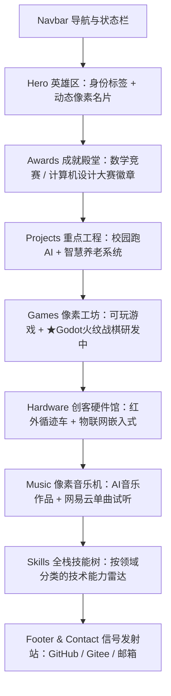

# 个人主页架构与设计方案：极简像素极客风 (Minimalist Pixel Geek)

> **目标**：打造一个兼具 **个人独特辨识度（独立游戏/软硬全栈）** 与 **求职专业度（结构清晰/突出贡献与硬核成果）** 的现代化交互式个人主页，并静态部署在 GitHub Pages。

---

## 一、 核心定位与思考：偏向个人风格 vs 偏向求职？

### 1. 深度分析
* **纯偏向求职（传统简历风）**：
  * 优点：HR 筛选效率高。
  * 致命缺点：千篇一律，淹没在成百上千份模板主页中。作为兼具 **数学竞赛获奖、软硬件协同开发、独立像素游戏制作、大模型应用落地** 的复合型开发者，传统模板会严重抹杀你的动手热情与创造力。
### 2. 最终定位建议：**“以求职实力为内核，以极简像素为皮肤”**
* **外在美学（个人风格）**：采用 **Neo-Pixel（新像素极简风）** —— 干净现代的排版架构 + 2px 像素边框与阴影 + 像素徽章与动效 + 8-bit 芯片音效（可选静音开关）。
* **内容深度（求职导向）**：项目介绍遵循 **STAR 法则**（背景、职责分工、技术栈、核心成果）。重点突出：
  * **软硬件贯通能力**：从单片机/传感器到云端/大模型，不是纸上谈兵。
  * **复合工程素养**：数学竞赛省二等奖（底层逻辑算法基础）+ 计算机设计大赛一等奖（落地能力）。
  * **独立创造力**：能独立开发并发布可玩的像素游戏。
* **贴心彩蛋功能**：在导航栏放置一个 **【一键生成/下载完整简历 (PDF)】** 或 **【视图切换：游戏模式 🎮 / 专注极简 📄】**，让技术面试官与 HR 都能以最舒服的方式阅读。

---

## 二、 页面结构与信息架构规划 (Sitemap)

整个页面采用模块化长单页设计，顶部提供像素平滑滚动导航，各模块按认知优先级排序：



### 1. Header & Navigation (顶栏)
* **像素 Logo**：动态小像素人/小图标 + 个人昵称。
* **快速锚点**：`[成就 Achievements]` · `[游戏 Games]` · `[项目 Projects]` · `[硬件 Lab]` · `[音乐 Music]` · `[关于 Me]`。
* **互动开关**：
  * 🎵 **背景音乐 (BGM) 全局联动控制**：与《アイスクリームと晴れ空》深度绑定，右上角喇叭支持一键由用户控制播放/暂停，带有跳动音波微动效，默认静音避免打扰；
  * 📄 简历导出 / 下载按钮。

### 2. Hero 区域 (第一印象)
* **动态元素**：
  * 像素风个人头像或像素机甲/角色（带微晃 Idle 呼吸动效）。
  * 动态打字机效果输出身份定位：
    * `> 全栈开发 & 独立游戏制作`
    * `> 软硬件协同工程师`
    * `> LLM 应用与系统落地探索者`
* **状态指示**：`● 处于活跃状态 / 寻找优秀机会`。
* **快捷行动组 (CTA)**：
  * `[🎮 试玩游戏]`（直达游戏区）
  * `[📦 浏览仓库]`（直达 GitHub / Gitee）
  * `[✉️ 联系我]`。

### 3. 成就与荣誉徽章 (Achievements & Awards)
> 放在项目前面作为硬核背书，增强求职信任度。
* **第17届全国大学生数学竞赛（非数学A类） 省二等奖**：
  * 像素金牌徽章 + 突出“扎实的算法与逻辑推演底蕴”。
* **第19届计算机设计大赛 河南财经政法大学 校一等奖**：
  * 像素奖杯徽章 + 突出“高水准的综合项目设计与工程落地能力”。

### 4. 独立游戏专区 (Pixel Arcade & Downloads)
采用**街机卡片**风格，卡片悬浮有 8-bit 抬升阴影：
1. **Kirogame (网页像素小游戏)**
   * **标签**：`Web` / `Canvas / JS` / `Open Source`
   * **特点**：纯前端像素设计小游戏，网页免下载即点即玩。
   * **交互按钮**：`[🌐 在线试玩]` · `[⭐ GitHub 源码]` (https://github.com/liliqqtu/kirogame)。
2. **2D 像素魂斗罗复刻/重制版 (.exe)**
   * **标签**：`Windows` / `Pixel Action` / `Executable`
   * **简介**：经典 2D 平台射击玩法，自定义物理碰撞、弹幕与敌人 AI。
   * **交互按钮**：`[⬇️ 下载客户端 (EXE)]` · `[🎥 玩法预览 GIF/视频]`。
3. **像素跑酷闯关游戏 (.exe)**
   * **标签**：`Windows` / `Platformer Runner` / `Executable`
   * **简介**：快节奏跳跃与障碍闪避机制，关卡地图设计与手感调优。
   * **交互按钮**：`[⬇️ 下载客户端 (EXE)]` · `[🎥 玩法预览 GIF/视频]`。
4. **【深度架构 · 研发中】战棋策略 RPG 原型 (Tactical Grid RPG - Fire Emblem Like)**
   * **引擎与语言**：`Godot Engine` / `GDScript`
   * **标签**：`Godot` / `Tactical RPG` / `In Development (WIP)`
   * **技术亮点**：
     * **A* 网格寻路**：棋盘格移动范围判别、地形消耗阻挡与视线判定；
     * **有限状态机 (FSM)**：严密管理玩家回合、敌方 AI 决策与战斗结算；
     * **属性相克与数值体系**：武器三角克制、命中/必杀概率公式与成长矩阵。
   * **求职价值**：证明具备从零驾驭高复杂度重度系统逻辑与开源商业引擎（Godot）的硬核开发能力。

### 5. 核心工程项目 (Featured Projects)
展示工业级/落地级软件系统，突出团队合作与解决复杂问题的能力：
1. **校园跑系统 (Campus Run with LLM)**
   * **仓库/代码**：`Gitee: LingYueQingChun`（说明：团队协同项目，本地备份完整源码 `E:\项目\xlzp`）。
   * **技术栈**：`Java / Spring Boot` · `Vue / UniApp` · `LLM API 接入 & 微调` · `MySQL / Redis`。
   * **你的核心贡献**：
     * 负责大模型（LLM）API 的全链路接入与响应流式封装。
     * 根据校园跑步与运动健康场景，对大模型进行针对性的 Prompt 调优与少量微调（Few-shot / Fine-tuning），实现智能配速建议、运动计划生成。
     * 解决前后端数据协同与业务接口调试。
2. **智慧养老综合服务系统 (Smart Elderly Care)**
   * **仓库**：`GitHub: liliqqtu/jiayouhuawei`。
   * **技术栈**：`嵌入式硬件` · `传感器采集` · `软硬件通信协议` · `移动端联动`。
   * **你的核心贡献**：
     * **负责全部硬件设计、制作与测试**：跌倒检测/生命体征监测/环境传感器模组。
     * **软硬件打通**：设计单片机到云端/App 的通信协议（串口/蓝牙/WiFi/MQTT），确保紧急警报毫秒级上报。
     * *（展示建议：在网页中附上硬件实物连线图、面包板/PCB照片及架构拓扑图）*。

### 6. 创客硬件实验室 (Hardware Lab)
展示极具极客精神的物理作品，证明不仅懂代码，更懂物理层实现：
* **红外循迹智能小车**：
  * 原理：多路红外反射传感器判别黑线，PID/逻辑调速控制电机差速转向。
  * 成果：流畅应对十字路口、锐角弯道与虚线轨迹。
* **智慧养老硬件模块原型**：
  * 传感器阵列集成、低功耗电源管理、状态机指示灯。

### 7. 数字创意与 AI 音频工坊 (AI Audio & Creative)
展示跨界 AIGC 探索与审美落地能力（已上架网易云音乐）：
* **交互形态**：复古像素磁带播放器（Retro Pixel Cassette），支持内嵌音频试听与网易云官方跳转。
* **首发单曲**：《アイスクリームと晴れ空》
  * **风格**：日系动漫 / 游戏原声 (J-Pop / Anime OST)
  * **创作方式**：基于 Generative AI 提示词编曲与调优，呈现明亮夏日与游戏元气氛围；
  * **入口**：`[☁️ 网易云音乐在线试听]` + `[网易云音乐人主页（可选）]`；
* **可拓展设计**：默认展示当前精选单曲，预留 `[展开更多歌曲 ▾]` 折叠逻辑，随着未来歌曲增加无缝扩展。

### 8. 技术技能矩阵 (Skills & Tools)
分类像素标签芯片：
* **游戏 & 引擎**：Godot Engine (GDScript), C#, Unity / 自研 2D 引擎, Aseprite (像素绘制), 碰撞检测, 状态机设计
* **后端 & AI**：Java, Spring Boot, Python, LLM API (Prompt Engineering / Fine-Tuning)
* **前端 & 移动端**：HTML5 / Canvas, Vue / UniApp, JavaScript / TypeScript, Tailwind CSS
* **硬件 & 嵌入式**：STM32 / 51单片机, 传感器模块集成, 串口/网络通信, 电路焊接与调试

---

## 三、 技术架构与选型 (组件化方案)

推荐技术栈：**Vite + Vue 3 / React + Tailwind CSS + Lucide 图标 + 像素字体**

### 1. 为什么采用 Vite 组件化？
* **组件高复用**：`GameCard`、`ProjectCard`、`AwardBadge`、`DownloadModal` 均为独立组件，后续新增游戏或仓库，只需改动 JSON 配置文件即可自动生成卡片。
* **极速开发与极小打包**：生成纯静态 HTML/CSS/JS，完美契合 GitHub Pages。
* **现代化交互支持**：
  * 弹窗组件：点击下载游戏时，弹出像素风格 Modal，提供多个下载源（GitHub Releases / 百度网盘 / 直链）及操作按键说明。
  * 图片/GIF 灯箱：点击图片查看硬件实物大图、软件架构图。

### 2. 目录结构设计 (Component Architecture)
```text
self_page/
├── index.html                   # 页面入口
├── package.json                 # 项目依赖配置
├── vite.config.js               # 构建配置（支持 GitHub Pages base path）
├── public/
│   ├── favicon.ico              # 像素风 Favicon
│   ├── fonts/                   # 像素英文字体 & 开源像素中文字体 (如 Fusion Pixel / Zpix)
│   ├── games/                   # 游戏封面 GIF/截图
│   ├── hardware/                # 硬件实物与接线照片
│   └── audio/                   # 8-bit 微音效 (hover.mp3, click.mp3)
└── src/
    ├── main.js                  # 入口逻辑
    ├── App.vue / App.jsx        # 根组件
    ├── assets/                  # 样式文件 (tailwind.css, pixel-theme.css)
    ├── data/                    # ★ 数据与内容驱动（所有项目/游戏数据在此维护）
    │   ├── profile.json         # 个人信息、荣誉奖项、社交账号
    │   ├── games.json           # 小游戏列表（支持在线玩的链接、EXE下载直链、封面）
    │   ├── projects.json        # 智慧养老、校园跑等重点工程
    │   └── hardware.json        # 红外小车、硬件实物
    └── components/              # 拆分的高内聚组件
        ├── Navbar.vue           # 顶部像素导航
        ├── HeroSection.vue      # 英雄区打字动效与名片
        ├── AwardShelf.vue       # 荣誉奖杯架
        ├── GameGrid.vue         # 游戏展台与下载控制
        ├── ProjectShowcase.vue  # 软件项目卡片（含 GitHub/Gitee 状态与本地标记）
        ├── HardwareLab.vue      # 硬件实验室图片墙与解析
        ├── DownloadModal.vue    # 游戏下载与运行说明弹窗
        └── Footer.vue           # 信号发射站与彩蛋
```

---

## 四、 针对你的关键疑难点与解决方案

1. **关于校园跑仓库 Gitee 5人访问限制问题**：
   * 在网页卡片上标注：`[协同开发 · 团队私有]`。
   * 同时附上详细的 **“系统架构图”** 和 **“本地运行演示截图/GIF”**（从本地 `E:\项目\xlzp` 中提取界面）。这样无需外部公开仓库，面试官也能百分百确认你对代码和业务的掌握程度。
2. **关于智慧养老仓库缺少 App 界面问题**：
   * 突出你的角色是 **“全部硬件研制与软硬互联架构师”**。重点展示硬件实物照片、电路图、传感器测试数据和通信报文。硬件能力反而是很多纯软件开发者的稀缺短板！
3. **大文件游戏下载 (.exe) 存放方案**：
   * 不要将几十兆/上百兆的 `.exe` 提交到网页仓库中。
   * 在 GitHub 上建一个统一的 `my-games-releases` 仓库，创建 Release，将 2D魂斗罗 和 跑酷闯关游戏的压缩包作为 Release Assets 上传。网页直接引用官方 CDN 下载直链，快速且零占用。

---

## 五、 后续实施路线图

1. **第 1 阶段**：搭建 Vite 骨架与“极简+像素”主题样式库（像素边框、字体、经典暗黑配色）。
2. **第 2 阶段**：整理本地媒体素材（从 `E:\项目\xlzp` 取几张运行界面，准备小车和养老硬件照片，准备 2 款 EXE 游戏的封面截图）。
3. **第 3 阶段**：实现组件化页面渲染与交互动效（点击弹窗、音效、直链跳转）。
4. **第 4 阶段**：配置 GitHub Actions 自动化工作流，一键 push 自动部署到 `<username>.github.io`。
